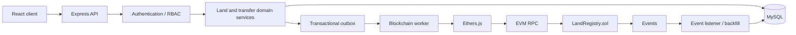

# LandRegistryChain — Blockchain Architecture

> **Implementation note.** This document defines the intended boundary. An initial
> implementation now exists: `blockchain/contracts/LandRegistry.sol`, Hardhat
> tests, the `blockchain_transactions` outbox table, `scripts/blockchain-worker.js`
> and `scripts/blockchain-listener.js`. Backfill/reorg handling, automated
> reconciliation and a confirmation policy are still incomplete.

This document defines the intended blockchain integration boundary for the existing Node.js + Express + MySQL backend. It is an architecture specification, not an implementation claim.

## System boundary

The existing Express API remains the entry point. The blockchain module is an infrastructure/integration layer called by approved domain services. It is not a replacement for land-registry business logic.

## Data placement

| MySQL | EVM blockchain |
|---|---|
| Personal data and user accounts | Pseudonymous owner references only |
| Parcel descriptions and precise GIS geometry | Stable parcel reference/digest |
| Application documents and approvals | SHA-256 document digest |
| Detailed transfer and ownership records | Verifiable ownership-change sequence |
| Transaction attempts, receipts, errors and retries | Contract state and immutable event history |
| Investigation evidence and access controls | No confidential evidence |

## Transaction lifecycle

Use a durable outbox because a MySQL commit and EVM transaction cannot be atomic:

`APPROVED_IN_DATABASE → OUTBOX_PENDING → SUBMITTED → CONFIRMED`

Failure states include `FAILED`, `REVERTED`, and `RETRY_PENDING`. A submitted transaction is not confirmed. The worker records the transaction hash, waits for a receipt and the chosen confirmation/finality policy, then updates MySQL. Reconciliation handles a chain success followed by a backend crash.

## Security boundaries

- API authentication and RBAC authorize the human actor.
- Domain services verify ownership, parcel status, approval and business constraints.
- A dedicated backend signer submits approved operations.
- Solidity access control independently restricts contract methods.
- Read-only provider credentials are separated from signing credentials.
- Private keys never enter the database, API response, logs, source control or frontend.
- Contract events and on-chain values contain no personal or confidential document data.

## Integration contract

The blockchain layer should accept a narrow, approved operation object from a domain service, containing only the stable parcel reference, pseudonymous owner reference, approved document digest/version (where relevant), and internal operation/idempotency reference. It should not accept raw user-supplied contract calldata or a signer address from the frontend.

The eventual blockchain worker and event listener run independently of HTTP request handling. The API can return an operation reference and current status while confirmation is pending.
