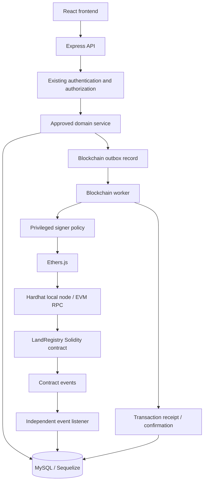

# LandRegistryChain — Blockchain Component Audit (Phase 1)

> **Historical document.** This Phase 1 audit was written before any blockchain code
> existed. A Hardhat project, `LandRegistry.sol`, contract tests, a transactional
> outbox, worker and listener now exist. See [`../README.md`](../README.md),
> [`API.md`](API.md) and [`BLOCKCHAIN_ARCHITECTURE.md`](BLOCKCHAIN_ARCHITECTURE.md)
> for the current implementation.

**Scope:** Blockchain integration only. This audit is based on the supplied `land-registry-backend-improved.zip` project. No source files outside `docs/` were changed. No smart contract, blockchain service, migration, route, or dependency was added in this phase.

## 1. Executive summary

The current backend is an Express 4 / Node.js ES-module application using Sequelize and MySQL. It has a usable application foundation and an initial authentication/user implementation. It does **not** currently contain a blockchain integration.

| Area | Finding | Evidence in current project |
|---|---|---|
| Node.js / Express | Exists | `src/app.js`, `src/server.js` |
| MySQL / Sequelize | Exists | `src/config/database.js`, `database/` |
| Authentication | Initial implementation exists | `src/modules/auth/`, `src/middleware/authenticate.js` |
| Backend roles | Initial role middleware exists | `src/middleware/authorize.js` |
| Land parcel model/module | Missing | No land module or land model found |
| Registration workflow | Missing | No registration module found |
| Ownership / transfer workflow | Missing | No ownership or transfer module/model found |
| Document storage / hashing | Missing | No document module or integrity service found |
| Ethers.js | Not installed | Not present in `package.json` |
| Hardhat | Not installed/configured | No Hardhat config or blockchain project found |
| Solidity contract | Missing | No `contracts/` directory or `.sol` file found |
| Blockchain provider/signer | Missing | No provider or signer service found |
| Blockchain transaction persistence | Missing | No blockchain transaction model/migration found |
| Outbox / retry / reconciliation | Missing | No outbox worker or reconciliation service found |
| Blockchain event listener | Missing | No event listener or event checkpoint model found |
| Blockchain API | Missing | No blockchain routes registered |
| Blockchain tests | Missing | No contract or blockchain integration tests found |

**Conclusion:** The current project can host a blockchain module, but it is not yet ready to execute real land-registry blockchain operations. The missing land, registration, ownership, and document workflows are important dependencies; the blockchain layer must integrate with them rather than inventing substitute records.

## 2. Existing backend capabilities relevant to blockchain

### 2.1 Application and API foundation

- `src/app.js` creates the Express application and installs Helmet, CORS, request IDs, Morgan logging, rate limiting, and JSON/form body parsing.
- `src/server.js` connects to MySQL before listening and supports graceful shutdown.
- `src/routes/index.js` mounts the current health, authentication, and user routes.
- Central error and 404 middleware are already present.

This is sufficient as the host application for a future blockchain router, but the blockchain router is not present and should not be mounted until its endpoints are implemented.

### 2.2 Database foundation

- Sequelize is configured for the MySQL dialect in `src/config/database.js`.
- Migrations are configured through `sequelize-cli`.
- The current improved archive contains a users/refresh-tokens migration.
- No blockchain-related models, migrations, or tables exist.

The database configuration currently exposes one runtime Sequelize connection. The migration configuration is separate. A future blockchain module should reuse the existing Sequelize instance and add migrations; it should not create a second unrelated database connection.

### 2.3 Authentication and authorization

The improved archive contains:
- JWT authentication middleware.
- A role-permission map for `landowner`, `registrar`, `administrator`, `investigator`, and `auditor`.
- An `authorize()` and `authorizeRoles()` middleware.

These are useful integration points. However, the current role middleware is not sufficient by itself for all blockchain operations:
- It has no blockchain-specific permissions.
- It does not implement parcel-level ownership checks.
- It does not prove that a registration or transfer has passed its business approval workflow.
- A backend role must not automatically grant a smart-contract role.
- The backend signer must remain separate from ordinary user accounts.

A future blockchain operation must check the authenticated user, their permission, the target parcel, the operation's approved status, and the trusted backend signer policy.

## 3. Missing dependencies and integration prerequisites

### 3.1 Required blockchain toolchain

| Dependency | Purpose | Current status |
|---|---|---|
| `ethers` v6 | Backend EVM provider, contract calls, event decoding, transaction receipts | Not installed |
| Hardhat 2 | Local EVM, compilation, deployment, contract testing | Not installed |
| `@nomicfoundation/hardhat-toolbox` compatible with Hardhat 2 | Hardhat Ethers integration and testing utilities | Not installed |
| `@openzeppelin/contracts` | Audited access-control and pause primitives | Not installed |
| Solidity compiler | Compile the contract; normally resolved/configured by Hardhat | Not configured |

`dotenv` is already present and can provide local development configuration. It must not be used as an excuse to commit real signer secrets. Production signing should be designed for a KMS/HSM or managed signer; local development may use a dedicated Hardhat test account.

Exact package versions should be pinned in Phase 2 after checking the installed Node/npm versions and resolving the Hardhat 2 plugin compatibility matrix. Do not install Hardhat 3 accidentally: the project brief specifically selects Hardhat 2 with Ethers 6.

### 3.2 Existing packages that can be reused

- `sequelize` and `mysql2`: blockchain transaction, outbox, event, and synchronization persistence.
- `zod`: validation of blockchain route inputs and environment configuration.
- `express`: protected API routes.
- `dotenv`: local environment configuration.
- `node:crypto`: SHA-256 hashing and random operation identifiers.
- Existing `authenticate` / `authorize` middleware: API access checks, extended only where needed.

## 4. Existing modules the blockchain layer depends on

The following modules do not exist yet in the inspected archive. They are dependencies, not features that should be fabricated inside the blockchain module.

| Dependency | Required capability before blockchain writes |
|---|---|
| Land parcels | Stable, unique parcel reference and authoritative parcel state |
| Registration applications | Approval status and approved registration data |
| Ownership | Current owner reference and ownership model |
| Transfers | Transfer request, approval, eligibility checks, and immutable history |
| Documents | Document ID, controlled file access, versioning, and SHA-256 digest |
| Audit | Traceable record of who approved and initiated an operation |
| Roles / permissions | Explicit permission to approve/submit each operation |
| Database migrations | Durable blockchain tables and foreign-key relationships |

**Important dependency rule:** The blockchain service should receive a validated, approved business operation from an existing domain service. It should not independently decide that a parcel is legally registered or that a transfer is valid.

If these modules are developed later, expose narrow service interfaces or approved-operation records for blockchain submission. Do not import controllers from one module into another.

## 5. Recommended responsibility split

### MySQL should store operational and private application data

Examples:
- User and owner records and personal information.
- Parcel details, coordinates, boundaries, and descriptive attributes.
- Registration and transfer applications, supporting documents, reviews, and approval decisions.
- Actual document files or secure storage references.
- Document metadata and SHA-256 hashes.
- Detailed ownership history linked to application records.
- Blockchain transaction lifecycle, receipts, retry attempts, and errors.
- Processed event identifiers and listener checkpoints.
- Audit records and operational status.

### The blockchain should store minimal, independently verifiable evidence

Recommended on-chain data:
- A stable parcel identifier (or its deterministic `bytes32` representation).
- A non-sensitive database record reference or a pseudonymous reference digest.
- A pseudonymous owner reference, not a name, national ID, phone number, or address.
- Registration/transfer timestamps and transaction history.
- SHA-256 document digests as `bytes32`, plus document/version references that reveal no confidential content.
- Parcel status needed for contract-enforced transfer restrictions.
- Events containing identifiers and hashes, not personal or confidential data.

Do not put title-deed files, identity documents, personal details, raw addresses, GPS coordinates, or confidential investigation evidence on a public blockchain. Even hashes and stable identifiers can be linkable; use a permissioned/local chain for development and assess privacy/linkability before any public deployment.

A SHA-256 digest is 32 bytes and can be represented as Solidity `bytes32`. The backend should hash the exact file bytes and use one documented canonical format. A matching digest proves byte-level equality with the previously hashed content; it does not prove that the document was legally issued or authentic.

## 6. Proposed end-to-end architecture

### Write path

1. An authenticated user submits a request through Express.
2. Existing domain logic validates the request and permissions.
3. An authorized business workflow approves the registration/transfer/document operation.
4. In one MySQL transaction, the domain service records the approved operation and an outbox item with a unique idempotency key.
5. A separate worker claims the outbox item and calls the blockchain service.
6. Ethers.js submits a transaction using a restricted signer.
7. The worker stores the transaction hash and tracks receipt/confirmation.
8. Only after the configured confirmation/finality policy is satisfied is the operation marked blockchain-confirmed.
9. A recovery/reconciliation process repairs the case where the chain succeeds but MySQL was not updated before a crash.

### Read path

- Read ordinary parcel/application details from MySQL.
- Read blockchain evidence using Ethers.js provider/contract read calls.
- Compare the relevant MySQL references/hashes with on-chain values.
- Return an explicit verification state such as `MATCH`, `MISMATCH`, `PENDING`, or `NOT_REGISTERED`.
- Do not present a database field as blockchain-verified unless the contract data/receipt has actually been checked.

### Why an outbox is recommended

MySQL and an EVM chain cannot participate in one atomic database transaction. The outbox pattern makes the operation durable before submission and supports safe recovery. The outbox worker must use idempotency keys and inspect existing transaction state before retrying. It must not blindly submit a second registration/transfer after an ambiguous timeout.

## 7. Smart-contract design decisions for Phase 2

Recommended first contract: `LandRegistry.sol`, non-upgradeable unless a documented requirement justifies upgradeability.

Recommended contract capabilities:
- AccessControl roles: default administrator, registrar, and blockchain operator.
- Parcel registration with duplicate protection.
- Ownership change with permanent append-only history.
- Document hash/version recording.
- Parcel status changes (active, frozen, disputed, suspended).
- Events for registration, transfer, hash recording, role changes, and status changes.
- Pause/emergency controls with narrowly defined authority.
- Custom errors and explicit input validation.

The contract must independently enforce its own permissions. Backend RBAC does not secure direct contract calls.

### Ownership-model recommendation

The current backend has no ownership schema or ownership workflow. The recommended project direction is to support **both single and joint ownership** from the first ownership implementation:

- Single ownership: one owner holds 100% of a parcel.
- Joint ownership: two or more owners hold defined shares in the same parcel.
- The total shares must equal 100%; an integer representation such as 10,000 basis points avoids floating-point arithmetic in the smart contract.
- Ownership history must be preserved when shares or owners change.
- The business/legal rule for joint-owner transfer approval (all owners, or an authorized representative) must be confirmed before implementation.

This is a recommended design decision, not an implemented feature. The database and Solidity contract must enforce consistent share rules.

### Status and transfer rule

The contract should reject ordinary transfers while a parcel is frozen, disputed, or suspended. Define which authorized registrar/governance role can set and clear each status, and ensure the backend workflow mirrors those rules.

## 8. Proposed blockchain data model additions

No blockchain tables should be added in Phase 1. When implementation is approved, add migrations (not `sequelize.sync`) for at least:

| Table/model | Purpose | Key safeguards |
|---|---|---|
| `blockchain_transactions` | Transaction intent, hash, chain, receipt, status, gas and error metadata | Unique transaction hash where present; unique idempotency key; indexed status and parcel reference |
| `blockchain_outbox` | Durable approved operations waiting for submission | Unique idempotency key; attempt count; lease/lock fields; retry schedule |
| `blockchain_events` | Decoded event processing and deduplication | Unique `(chain_id, transaction_hash, log_index)` |
| `blockchain_networks` | Network and deployed contract metadata | Chain ID and contract address; no private keys |
| `blockchain_checkpoints` | Last finalized/scanned block per network/contract | Unique network/contract checkpoint |
| `document_hashes` | Document version digest and verification state | Foreign keys to existing document/parcel records once those modules exist |
| `ownership_history` | Ownership changes linked to transfers and blockchain receipts | Must integrate with the authoritative ownership model; do not create a duplicate if one is later implemented |

The final schema must be adapted to actual land/document/ownership model primary keys. Do not guess foreign-key types or create duplicate parcel/owner tables.

## 9. API surface proposed (not implemented)

The eventual blockchain API may expose:
- `GET /api/blockchain/network`
- `GET /api/blockchain/status`
- `GET /api/blockchain/lands/:parcelId`
- `GET /api/blockchain/lands/:parcelId/history`
- `GET /api/blockchain/transactions/:hash`
- `GET /api/blockchain/verify/:parcelId`
- Protected submission operations for approved registration, approved transfer, and document hash recording.

The API should not expose a general-purpose endpoint that lets a client call arbitrary contract functions or select the privileged signer. Submission routes must call the relevant domain service, verify an approved operation, and then enqueue an outbox item. Do not add these routes until their dependencies and behavior exist.

## 10. Recommended implementation order

| Phase | Work | Exit condition |
|---|---|---|
| 1 — Audit (current) | Inspect existing code, identify dependencies, define architecture and decisions | This report reviewed and approved |
| 2 — Toolchain | Pin compatible Hardhat 2 / Ethers 6 / OpenZeppelin versions; local node and provider connectivity | Local node starts; backend reads chain ID |
| 3 — Contract | Implement roles, parcel registration, ownership history, hashes, statuses and events | Contract compiles |
| 4 — Contract tests | Test normal and unauthorized calls, duplicates, history and statuses | Automated tests pass |
| 5 — Deployment | Local deployment, ABI/address artifact and chain ID checks | Backend reads deployed contract |
| 6 — Persistence and outbox | Add migrations and worker with idempotency/recovery | Durable operation processing works |
| 7 — Backend services | Ethers provider, read service, signer, transaction lifecycle | Real contract calls work |
| 8 — Domain integration | Connect only to approved land/registration/transfer/document operations as those modules become available | Full approved workflow succeeds |
| 9 — Events and reconciliation | Listener, deduplication, checkpointing, backfill and reorg policy | Restart/recovery tests pass |
| 10 — API and documentation | Protected endpoints, OpenAPI, operational guides | API tests and docs complete |
| 11 — Security/integration tests | End-to-end workflow, signer and role tests, failure recovery | Acceptance criteria pass |

## 11. Recommended decisions and items still requiring confirmation

| Area | Recommended direction | Status |
|---|---|---|
| Development network | Local Hardhat network first | Recommended; not installed |
| Later test network | Ethereum Sepolia after local testing and review | Future option; not configured |
| Database | Existing MySQL/Sequelize backend | Configured; local database execution must be verified |
| Smart-contract language | Solidity | Recommended; no contract exists |
| Backend blockchain library | Ethers.js v6 | Recommended; not installed |
| Ownership | Both single and joint ownership with explicit shares | Recommended; not implemented |
| On-chain owner reference | Backend-generated pseudonymous reference; no personal data | Recommended; not implemented |

Still confirm before implementation:
1. The legal/business rule for joint-owner transfer approval.
2. The signer model and operational key custody. Use a dedicated local Hardhat test account during development; never reuse public Hardhat test keys on a public network.
3. Whether registrar approval is sufficient for prototype operations or sensitive operations need a second approver.
4. Whether the local database service is MySQL 8 or MariaDB before selecting database-specific spatial/data-type features.

Sepolia is not the first development environment. First prove contract compilation, deployment, tests, and Ethers.js connectivity against the local Hardhat chain.

## 12. Phase 1 conclusion

The existing improved backend provides the application, MySQL, Sequelize, authentication, and initial RBAC foundation. It has no blockchain implementation and no land/registration/ownership/document domain modules to feed it.

The correct next step is **not** to write a standalone contract and pretend it is integrated. After approval, Phase 2 should add only the blockchain development toolchain and prove a local Hardhat node can be reached by Ethers.js from the backend. Later phases should add the contract and integration around the real approved domain workflows.

**Scope protection:** This Phase 1 audit adds documentation only. It does not modify authentication, users, database setup, land-management code, frontend code, or any other application module.
